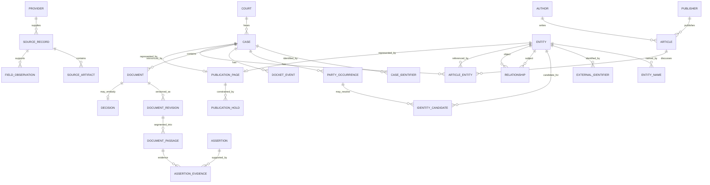

# Jurvio Gate 4A: Canonical Data Model and ERD

**Status:** Approved  
**Date:** 2026-07-19  
**Depends on:** Approved Gates 1–3

## 1. Decision summary

PostgreSQL is Jurvio's canonical system of record. S3-compatible object storage holds immutable source artifacts. Search indexes, page projections, embeddings, and AI outputs are derived and rebuildable; none is authoritative.

The model separates five concerns:

1. immutable provider evidence;
2. normalized legal records;
3. resolved real-world entities;
4. sourced assertions and relationships;
5. publication and operational state.

This is a relational knowledge graph, not a separate graph database. Jurvio should reconsider a graph database only after measured multi-hop workloads cannot meet product targets in PostgreSQL or the search layer.

## 2. Identifier policy

- Public entities receive opaque, time-sortable Jurvio IDs (UUIDv7 or an equivalent implementation-supported format).
- Provider IDs remain aliases and never become public canonical IDs.
- Natural keys enforce uniqueness where reliable, but are not URLs.
- Slugs are presentation fields and may change without changing identity.
- Merges and splits are explicit, reversible records with redirects and audit history.

## 3. Logical schemas

| Schema | Responsibility | Examples |
|---|---|---|
| `source` | Immutable acquisition evidence | providers, fetches, records, artifacts, rights policies |
| `legal` | Canonical legal records | courts, cases, dockets, documents, decisions, occurrences |
| `entity` | Resolved identities | people, organizations, attorneys, judges, firms, names |
| `knowledge` | Assertions and graph edges | relationships, assertions, citations, topics, evidence links |
| `content` | Attributed secondary material | publications, authors, articles, case commentary links |
| `publication` | Public eligibility and corrections | page state, holds, redirects, disputes |
| `ops` | Processing control and cost | jobs, attempts, checkpoints, cost ledger |

These are namespaces inside one PostgreSQL deployment, not microservices or separate databases.

## 4. Core tables

### Source and provenance

- `source.providers`: provider identity, adapter version, terms/rights policy, trust class.
- `source.fetches`: request identity, retrieval time, status, headers, cursor/checkpoint and cost.
- `source.records`: immutable provider record revision, source ID, checksum, observed timestamps and raw artifact pointer.
- `source.artifacts`: immutable PDF/HTML/JSON/text object, MIME type, byte checksum, size, encryption and retention class.
- `source.field_observations`: optional field-level value, source record, parser version and confidence for conflict resolution.

Unique constraint: `(provider_id, provider_record_type, provider_record_id, payload_checksum)`. Re-fetching identical bytes creates no new revision.

### Legal record

- `legal.courts` and `legal.court_identifiers`.
- `legal.cases`, `legal.case_identifiers` and `legal.case_captions`.
- `legal.docket_events` and `legal.docket_event_revisions`.
- `legal.documents`, `legal.document_revisions` and `legal.document_passages`.
- `legal.decisions` and `legal.decision_dispositions`.
- `legal.party_occurrences` and `legal.participant_occurrences`.
- `legal.authorities` and `legal.citations`.

The logical document is stable; each file/text change creates an immutable document revision. Passage anchors belong to a revision and use page plus deterministic block identifiers.

### Resolved entity

- `entity.entities`: shared identity envelope and type.
- `entity.people`, `entity.organizations`, `entity.attorneys`, `entity.judges`, `entity.law_firms`.
- `entity.names`: exact and normalized names with type, language, dates, source and display status.
- `entity.external_identifiers`: bar numbers, court IDs, government IDs and verified domains.
- `entity.identity_candidates`: candidate occurrence-to-entity links, signals, state and method.
- `entity.identity_decisions`: verification, rejection, dispute, merge and split audit records.

An attorney or judge is a professional role attached to a person envelope where identity is verified. Jurvio may still store an unresolved professional occurrence without creating a canonical person profile.

### Knowledge and evidence

- `knowledge.relationships`: typed subject–predicate–object edges with effective dates, confidence, review and supersession.
- `knowledge.assertions`: evidence-typed text or structured fact, generator/editor and publication status.
- `knowledge.assertion_evidence`: assertion-to-source passage links and support role.
- `knowledge.topics` and `knowledge.entity_topics`.
- `knowledge.related_cases`: explicit relationship type before semantic similarity.

Every material public derived statement must resolve to one or more evidence records or explicitly state that evidence alignment is unavailable.

### Secondary content

- `content.publishers`: law firm, newsroom, attorney blog, journal or other publisher.
- `content.authors`: sourced author identity and optional verified entity link.
- `content.articles`: canonical URL, title, publication/update dates, rights class, discovery source and content checksum where storage is permitted.
- `content.article_entities`: article-to-case/person/organization/attorney links with extraction method and review state.
- `content.article_excerpts`: only text Jurvio is authorized to store/display, with word/character limits and license basis.
- `content.article_summaries`: Jurvio-authored, versioned summaries with attribution and source URL.
- `content.submissions`: claimed-profile or publisher-submitted links, disclosures and moderation state.

Representation relationships are explicit. Commentary written by counsel in the case must display that relationship and must not be presented as independent reporting.

### Publication and operations

- `publication.pages`: canonical route, entity, eligibility state, quality score, canonical metadata and last rendered version.
- `publication.holds`: sealing, redaction, privacy, identity, rights or legal-review hold.
- `publication.redirects`: immutable former route to canonical entity.
- `publication.corrections` and `publication.disputes`.
- `ops.jobs`, `ops.job_attempts`, `ops.checkpoints`, `ops.dead_letters` and `ops.cost_ledger`.

## 5. ERD

The production ERD will expand table columns and cardinalities, but this is the approved conceptual boundary.

## 6. Normalization rules

1. Preserve exact source values before normalizing.
2. Normalize identifiers by jurisdiction-specific rules; never use one universal docket parser.
3. Store dates with precision (`day`, `month`, `year`, `unknown`) and source timezone when applicable.
4. Store money as amount plus currency; never as formatted text.
5. Use controlled vocabularies for roles, document types, event types, evidence classes and relationship types; retain unmapped source labels.
6. Keep allegations, arguments, findings, orders and dispositions distinct.
7. Represent unknown separately from false, not applicable and withheld.
8. Treat names and affiliations as sourced, time-bounded assertions.
9. Do not collapse parent, subsidiary, trade name and law-firm office relationships.
10. Soft publication withdrawal does not delete immutable source evidence.

## 7. Canonical-field conflict resolution

Canonical fields are projections from observations. Selection considers:

1. publication hold or withdrawal status;
2. source authority class;
3. whether the observation is direct or derived;
4. source freshness and effective date;
5. parser confidence;
6. human override;
7. stable deterministic tie-breaker.

Conflicts remain visible internally. A new source never silently overwrites history. Human overrides require reason, actor and supporting evidence and may be superseded.

## 8. Partitioning and retention

- Begin without table partitioning except where benchmarked bulk tables justify it.
- Likely future partition candidates: source records, job attempts, docket events, passages and cost ledger.
- Index the query paths actually used; avoid indexing every foreign key and JSON field by habit.
- Keep raw artifacts under rights, security and retention policies; do not store prohibited material merely because it was technically retrievable.
- PostgreSQL JSONB is acceptable for raw adapter envelopes and rare provider extensions, not as a substitute for canonical columns.

## 9. Attorney and law-firm expansion policy

Jurvio may create nationwide attorney records internally, but public pages require:

- verified identity or clearly scoped professional occurrence;
- official identifier or independently reliable professional context;
- substantive case relationships in the covered corpus or adequate official biography;
- visible corpus-coverage disclaimer;
- correction/claim workflow;
- no copied third-party rating or implied comprehensive client history.

Third-party ratings require a documented license and methodology. Jurvio-native ratings are outside v1. Factual analytics may be considered later only with procedural context, statistical sufficiency and legal/product review.

## 10. Alternatives considered

| Alternative | Why not now | Reconsider when |
|---|---|---|
| Graph database as canonical store | Extra operational model and weak fit for transactional provenance | PostgreSQL cannot meet measured multi-hop workloads |
| Provider-shaped databases | Creates lock-in and inconsistent public facts | Never as canonical; allowed only in raw staging |
| Event sourcing for every change | Complexity exceeds early benefit | Auditing/temporal requirements outgrow revision tables |
| Separate service database per domain | Premature distributed transactions and operations | Independent teams and scaling boundaries are demonstrated |
| One giant entity table | Obscures legal distinctions and constraints | Not recommended |

## 11. Gate 4A decisions requested

1. Approve PostgreSQL as canonical source of truth and object storage for immutable artifacts.
2. Approve the relational knowledge-graph model without a graph database at launch.
3. Approve opaque stable IDs, immutable revisions and reversible merge/split history.
4. Approve assertions and relationships as sourced, versioned first-class records.
5. Approve secondary commentary as attributed linked content, separated from court facts.
6. Approve attorney pages only after identity and minimum-content thresholds; defer ratings.

